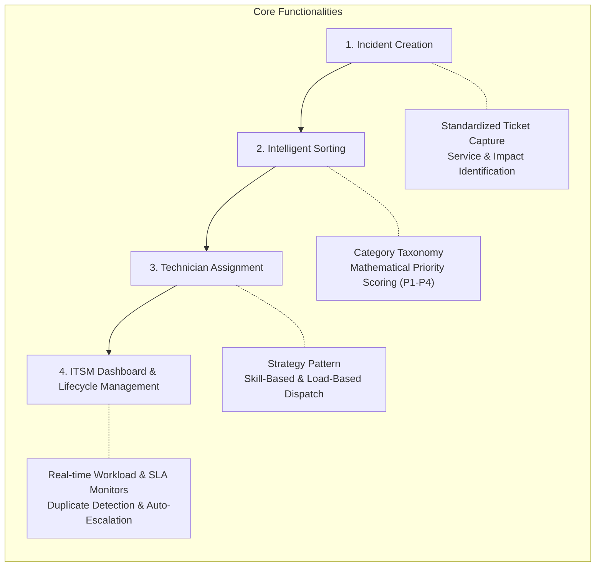

# Intelligent IT Service Management & Incident Resolution System (I-ITSM)
## Deliverable 1: Problem Analysis & Deliverable 2: Requirements Specification

> **Scope Note:** The system is explicitly focused on the core incident management lifecycle: **Incident Creation**, **Sorting (Classification & Priority Determination)**, **Technician Assignment**, and **ITSM Operational Dashboard Management** (SLA tracking, workload monitoring, duplicate detection, and lifecycle resolution). No external payment or billing gateways are involved.

---

# SECTION 1: DELIVERABLE 1 — PROBLEM ANALYSIS

### 1.1 Context and Background
Modern enterprise organizations rely on an interconnected ecosystem of internal IT infrastructure and software services to conduct daily operations. These include enterprise resource planning (ERP) platforms, customer relationship management (CRM) systems, central authentication systems (Single Sign-On / LDAP / Active Directory), corporate databases, virtual private networks (VPN), cloud storage, and internal developer platforms.

When any of these IT services experience degradation, unexpected behavior, or downtime, employee productivity stalls and internal operational workflows halt. In organizations supporting hundreds or thousands of users, the IT support desk receives dozens or hundreds of incident reports each day. Without a dedicated, intelligent system, incidents are submitted through fragmented channels (emails, spreadsheets, chat messages, or phone calls), creating operational bottlenecks in receiving, sorting, assigning, and tracking tickets through to resolution.

---

### 1.2 The Core Problem Statement
The central problem addressed by this project is:
> **How can an organization systematically, reliably, and intelligently manage the core IT incident management workflow—specifically incident creation, intelligent sorting (classification & prioritization), technician assignment, and operational dashboard management—through sound object-oriented software design?**

Without an integrated I-ITSM solution, organizations face recurring operational breakdowns:
1. **Delayed Incident Triage & Response:** Manual intake delays the discovery and initial response to critical service disruptions.
2. **Subjective and Erroneous Sorting:** Requesters assign arbitrary priority ratings without understanding broader system impact, leading to misallocated technical effort.
3. **Inefficient & Opaque Technician Assignment:** Incidents are dispatched manually without real-time insight into technician skills, schedule availability, or current ticket backlogs.
4. **Passive SLA Tracking & Lack of Visibility:** Support leads lack a unified dashboard to monitor response and resolution deadlines, learning of SLA breaches only after frustrated users follow up.
5. **Queue Clutter from Duplicate Incidents:** During major service interruptions (e.g., an SSO cluster or VPN failure), multiple employees submit identical tickets, flooding queues and obscuring distinct, isolated issues.
6. **Incomplete Audit Trails:** Informal troubleshooting without centralized state tracking makes post-incident analysis, root-cause identification, and performance auditing impossible.

---

### 1.3 Stakeholders

| Stakeholder Group | Role in the Ecosystem | Primary Objectives & Interests |
| :--- | :--- | :--- |
| **Enterprise Employees / End Users** | Incident reporters who consume internal IT services. | Clean interface to report incidents, track real-time status on a personalized dashboard, communicate updates, and verify resolutions. |
| **IT Support Engineers / Technicians** | Technical resolvers handling domain-specific incidents. | Streamlined dashboard queue, automated skill-matched ticket assignments, clear priority indicators, and workload limit protection. |
| **IT Team Leads / Escalation Managers** | Supervisors overseeing queue velocity and team throughput. | Real-time queue oversight, automatic escalation handling for stalled tickets, technician workload balancing, and re-assignment controls. |
| **IT Administrators / IT Managers** | System governors defining operational rules and policies. | Full administrative dashboard: SLA policy configuration, assignment strategy selection, service catalog management, and audit log inspection. |

---

### 1.4 Existing Challenges
Traditional or ad-hoc incident management workflows suffer from four distinct operational bottlenecks:

1. **Intake & Creation Friction:** Disorganized incident reporting with incomplete problem descriptions, missing category tagging, and no standardized capture of affected services.
2. **Sorting Deficiencies (Classification & Prioritization):** Lack of algorithmic priority computation. Critical infrastructure outages are treated with the same urgency as routine password resets or desktop peripheral issues.
3. **Dispatch & Assignment Imbalance:** Static or manual dispatch results in certain technicians being overwhelmed with active tickets while domain specialists remain unassigned.
4. **Dashboard & Operational Blindness:** Absence of a centralized, real-time ITSM dashboard leaves managers unable to track SLA compliance, identify recurring duplicate incidents, or evaluate team capacity.

---

### 1.5 Proposed Solution: Focused I-ITSM Architecture
The proposed solution is an **Intelligent IT Service Management & Incident Resolution System (I-ITSM)** engineered strictly around four cohesive operational pillars:

1. **Structured Incident Creation:** Captures rich, structured ticket details (title, description, affected service, category, user-perceived urgency, and scope of impact).
2. **Algorithmic Sorting (Classification & Prioritization):** Automatically evaluates the incident's impact, urgency, affected service criticality, and scope to calculate a deterministic Priority Score mapped to P1 (Critical), P2 (High), P3 (Medium), or P4 (Low).
3. **Strategy-Driven Technician Assignment:** Implemented via the **Strategy Pattern**, supporting interchangeable dispatch logic:
   - *Skill-Based:* Routes tickets to available technicians certified in the incident's technical domain.
   - *Load-Based:* Selects technicians with the lowest active workload ratio.
   - *Round-Robin Fallback:* Cyclical distribution to guarantee fair baseline allocation.
4. **Unified ITSM Operational Dashboard:** Role-tailored dashboards providing real-time visibility into:
   - Active ticket queues and lifecycle state progression (`NEW` to `CLOSED`).
   - SLA deadline timers with proactive 75% elapsed warning indicators.
   - Technician workload tracking and capacity ceilings.
   - Automated duplicate incident alerts.
   - Multi-tier automatic escalation management.
   - Immutable audit history and notification activity.

---

### 1.6 Assumptions
The project scope is framed under the following explicit assumptions:

1. **Enterprise User Directory:** Users (Employees, Technicians, Team Leads, Administrators) authenticate with pre-registered enterprise accounts and assigned roles.
2. **Service Catalog Definition:** Digital IT services (e.g., Enterprise Database, Corporate Network/VPN, Central SSO/Auth, ERP/CRM, Cloud Storage) and their baseline criticality levels are pre-seeded in the database.
3. **Technician Availability & Shifts:** Technicians manage their operational availability (`AVAILABLE`, `ON_LEAVE`, `OFF_DUTY`) and have defined maximum concurrent workload limits.
4. **Zero Financial / Billing Dependencies:** The system operates strictly within internal enterprise IT service management; no payment gateways, invoicing, or external financial transactions are in scope.
5. **Synchronized System Time:** All deadline calculations, SLA breach detections, and audit timestamps rely on a synchronized UTC server clock.
6. **Persistence Layer:** All operational state (tickets, assignments, audit trails, user accounts) is persistently stored in a relational PostgreSQL database with ACID transaction boundaries.

---

# SECTION 2: DELIVERABLE 2 — REQUIREMENTS SPECIFICATION

---

### 2.1 User Roles and Permissions Matrix

The system enforces Role-Based Access Control (RBAC) across four operational personas:

| Capability / Action | Employee (Requester) | Technician (Engineer) | Team Lead (Escalation Mgr) | Administrator (IT Manager) |
| :--- | :---: | :---: | :---: | :---: |
| **Authenticate / Login** | Yes | Yes | Yes | Yes |
| **Create Incident Ticket** | Yes | Yes | Yes | Yes |
| **View Personal Reported Tickets** | Yes | Yes | Yes | Yes |
| **View Assigned Queue on Dashboard** | No | Yes (Assigned) | Yes (Team) | Yes (All) |
| **Acknowledge Incident** | No | Yes (Assigned) | Yes | Yes |
| **Update Investigation / Add Notes** | Yes (Comments) | Yes | Yes | Yes |
| **Mark Incident Resolved** | No | Yes (Assigned) | Yes | Yes |
| **Verify Resolution & Close Ticket** | Yes (Own ticket) | No | Yes (Override) | Yes (Override) |
| **Manual Technician Reassignment** | No | No | Yes | Yes |
| **View SLA Warnings & Breaches** | No | Yes (Assigned) | Yes (Team) | Yes (Global) |
| **Configure Assignment Strategies** | No | No | No | Yes |
| **Configure SLA Policies & Services** | No | No | No | Yes |
| **Manage Technicians & Capacity** | No | No | No | Yes |
| **View Full Enterprise Audit Trail** | No | No | Limited | Yes |

---

### 2.2 Functional Requirements (FRs)

#### Module 1: Incident Creation
- **FR-1.1:** The system shall provide an intuitive ticket reporting form for employees to report IT issues, capturing:
  - Incident Title (concise summary)
  - Detailed Problem Description
  - Affected Digital Service (e.g., Corporate Network, SSO / Auth, Database, Cloud Storage, ERP/CRM)
  - Incident Category (`Hardware`, `Software`, `Network`, `Database`, `Cloud`, `Security`, `Authentication`, `Application`, `Storage`)
  - User-Reported Urgency (`LOW`, `MEDIUM`, `HIGH`, `CRITICAL`)
  - Scope of Impact (`INDIVIDUAL`, `DEPARTMENT`, `ORGANIZATION_WIDE`)
- **FR-1.2:** The system shall generate a globally unique Incident Identifier (e.g., `INC-20261108-0012`), timestamp the creation in UTC, set the initial status to `NEW`, and link the ticket to the reporter's profile.

#### Module 2: Incident Sorting (Classification & Prioritization)
- **FR-2.1:** Upon ticket creation, the system shall execute an automated classification and priority scoring engine.
- **FR-2.2:** The system shall compute a deterministic Priority Score using the formula:
  $$\text{Priority Score} = (\text{Impact} \times \text{Urgency} \times \text{Business Criticality Factor}) + \text{Service Weight}$$
- **FR-2.3:** The system shall sort and categorize incidents into four formal priority levels based on calculated scores:
  - **P1 — Critical:** Organization-wide failure of mission-critical service (Response: 5 min, Resolution: 30 min).
  - **P2 — High:** Departmental outage or major service degradation (Response: 15 min, Resolution: 2 hr).
  - **P3 — Medium:** Localized disruption with partial workaround available (Response: 1 hr, Resolution: 8 hr).
  - **P4 — Low:** Minor technical inconvenience or cosmetic issue (Response: 4 hr, Resolution: 24 hr).
- **FR-2.4:** The system shall update the incident state from `NEW` to `CLASSIFIED` once priority scoring and category sorting complete.

#### Module 3: Technician Assignment Engine
- **FR-3.1:** The system shall implement dynamic technician assignment via the **Strategy Pattern**, supporting multiple interchangeable strategies configured by the Administrator:
  - **Skill-Based Assignment Strategy:** Identifies technicians whose certified technical skills match the incident category, filters for active `AVAILABLE` status, and assigns the ticket to the technician with the lowest active workload count.
  - **Load-Based Assignment Strategy:** Evaluates all active, available technicians and assigns the ticket to the individual with the lowest capacity utilization ratio ($\text{Active Tickets} / \text{Max Workload Cap}$).
  - **Round-Robin Fallback Strategy:** Distributes incidents cyclically across eligible technicians when skill and load metrics are identical.
- **FR-3.2:** The system shall enforce workload capacity guardrails, preventing automated ticket dispatch to any technician whose active count has reached their configured maximum limit (default: 5 concurrent tickets).
- **FR-3.3:** Upon successful technician assignment, the incident state shall transition from `CLASSIFIED` to `ASSIGNED`, and an assignment notification shall be dispatched.

#### Module 4: Incident Lifecycle State Machine
- **FR-4.1:** The system shall manage the complete incident lifecycle using the **State Pattern**, strictly enforcing the 8-stage sequence:
  $$\text{NEW} \longrightarrow \text{CLASSIFIED} \longrightarrow \text{ASSIGNED} \longrightarrow \text{ACKNOWLEDGED} \longrightarrow \text{IN\_PROGRESS} \longrightarrow \text{RESOLVED} \longrightarrow \text{VERIFIED} \longrightarrow \text{CLOSED}$$
- **FR-4.2:** The system shall prevent invalid or out-of-order state transitions (e.g., jumping from `NEW` to `CLOSED` or `ASSIGNED` to `RESOLVED`), throwing an `InvalidStateTransitionException` upon illegal attempts.
- **FR-4.3:** Transition from `ASSIGNED` to `ACKNOWLEDGED` shall record the formal **Response Time** milestone.
- **FR-4.4:** Transition from `IN_PROGRESS` to `RESOLVED` shall require the technician to supply resolution notes and root-cause details, recording the **Resolution Time** milestone.
- **FR-4.5:** Transition from `RESOLVED` to `VERIFIED` and `CLOSED` shall be performed by the reporting employee (confirming satisfaction) or by an Administrator.

#### Module 5: ITSM Operational Dashboard
- **FR-5.1 (Technician Queue View):** Technicians shall have a dedicated dashboard displaying their assigned active incidents, priority badges, remaining SLA countdown timers, and quick-action buttons for status advancement (`Acknowledge`, `Start Investigation`, `Resolve`).
- **FR-5.2 (Team Lead & Manager Oversight View):** Team leads and administrators shall have a live operational dashboard showing:
  - Incident Overview: Total active, critical P1, resolved, and breached tickets.
  - Workload Monitor: Active ticket counts per technician against their maximum capacity limit.
  - Service Health Summary: Aggregated incident counts grouped by affected digital service.
- **FR-5.3 (Multi-Criteria Search & Filtering):** The dashboard shall provide real-time search and filtering by Incident ID, Date Range, Status, Priority, Category, Service, Assigned Technician, and SLA Status (`NORMAL`, `WARNING`, `BREACHED`).
- **FR-5.4 (Employee Self-Service Portal):** Employees shall have a clean dashboard view showing their submitted tickets, real-time status badges, investigation updates, and verification prompts.

#### Module 6: SLA Monitoring & Intelligent Escalation
- **FR-6.1:** A scheduled background engine shall monitor active incidents every 60 seconds against response and resolution targets.
- **FR-6.2:** The dashboard shall display an **SLA Warning** alert and highlight tickets in yellow/orange when 75% of the allotted time window has elapsed without reaching the milestone.
- **FR-6.3:** If an incident surpasses 100% of its target, the system shall mark `slaBreached = true`, display a red breach badge on the dashboard, and log an SLA breach audit record.
- **FR-6.4 (Multi-Tier Automatic Escalation):**
  - If a P1 incident remains in `ASSIGNED` state without technician acknowledgment past its 5-minute response window, it shall automatically escalate to the Team Lead.
  - If a P1 incident remains unresolved at 75% of its resolution window, an escalation alert shall be routed directly to the IT Administrator.

#### Module 7: Duplicate Incident Detection
- **FR-7.1:** During ticket creation, the system shall compare the incoming title and description against all open incidents affecting the same digital service.
- **FR-7.2:** If textual and token similarity exceeds an 80% threshold, the system shall tag the new incident as a **Potential Duplicate**, link the primary parent ticket ID, and flag the correlation on the technician dashboard to prevent redundant troubleshooting.

#### Module 8: Notifications & Audit Logging
- **FR-8.1:** Decoupled event publication via the **Observer Pattern** for events: `IncidentCreated`, `IncidentAssigned`, `IncidentAcknowledged`, `SlaWarning`, `SlaBreached`, `IncidentEscalated`, `IncidentResolved`, `IncidentClosed`.
- **FR-8.2:** In-app real-time notification alerts shall update dashboard notification bells for logged-in users.
- **FR-8.3:** Live email notifications shall be dispatched via standard SMTP (e.g., Mailtrap / SendGrid) to affected reporters and technicians.
- **FR-8.4:** The dashboard shall provide an immutable, append-only audit trail displaying timestamp, actor, action, previous status, new status, and description for every incident.

---

### 2.3 Non-Functional Requirements (NFRs)

#### 1. Performance and Responsiveness
- **NFR-1.1 (Dashboard & API Latency):** Synchronous dashboard queries, ticket sorting, and filter requests shall return in $\le 500\text{ ms}$ under 100 concurrent user sessions.
- **NFR-1.2 (Sorting & Priority Evaluation):** Automated priority calculation and duplicate similarity scoring shall execute in $\le 100\text{ ms}$ during ticket creation.
- **NFR-1.3 (Scheduler Execution):** The background SLA monitor sweep shall complete within $\le 2\text{ seconds}$ per cycle without locking ticket rows.

#### 2. Security and Access Control
- **NFR-2.1 (Credential Protection):** All passwords shall be hashed using BCrypt (work factor 10). Plaintext passwords shall never be persisted or logged.
- **NFR-2.2 (Stateless Authentication):** Secure client-server communication using signed JWT tokens passed via HTTP `Authorization: Bearer` headers.
- **NFR-2.3 (Data Isolation):** Employees can view only their own submitted tickets. Technicians can view tickets assigned to their queue or team. Administrators retain global visibility.
- **NFR-2.4 (Input Sanitization):** All ticket titles, descriptions, and resolution notes shall be sanitized against XSS and SQL injection.

#### 3. Reliability and Data Consistency
- **NFR-3.1 (ACID Transactions):** Ticket state transitions, assignment updates, and audit trail insertions must occur within atomic database transactions (`@Transactional`).
- **NFR-3.2 (Graceful Degradation):** Inability to reach external SMTP mail servers shall be logged as a warning without failing or rolling back the primary ticket state transition.
- **NFR-3.3 (Data Integrity):** Relational integrity enforced through foreign keys, not-null constraints, and enumeration checks in PostgreSQL.

#### 4. Object-Oriented Design & Maintainability
- **NFR-4.1 (SOLID Principles):** Strict adherence to Single Responsibility, Open/Closed (extensible strategies and notification handlers without modifying core controllers), Liskov Substitution, Interface Segregation, and Dependency Inversion.
- **NFR-4.2 (Design Patterns Manifest):**
  - **Strategy Pattern:** Interchangeable assignment algorithms (`SkillBasedStrategy`, `LoadBasedStrategy`, `RoundRobinStrategy`).
  - **State Pattern:** Encapsulated state behavior for the 8 sequential lifecycle phases.
  - **Observer Pattern:** Decoupled event publication for audit logs and multi-channel notifications.
  - **Factory Pattern:** Standardized instantiation of domain incident and notification objects.

#### 5. Dashboard Usability & Ergonomics
- **NFR-5.1 (Visual Hierarchy):** Clear color-coded indicators for priority levels (P1: Red, P2: Orange, P3: Yellow, P4: Blue/Green) and SLA health (Normal: Green, Warning: Yellow, Breached: Red).
- **NFR-5.2 (Responsive Layout):** Dashboard interfaces designed for seamless operation on standard enterprise workstation displays ($\ge 1024\text{px}$).

---

### 2.4 Business Rules Specification

#### Category BR-1: Incident Lifecycle & Transition Rules
- **BR-1.1 (Strict Progression):** Incidents must progress strictly through:
  $$\text{NEW} \rightarrow \text{CLASSIFIED} \rightarrow \text{ASSIGNED} \rightarrow \text{ACKNOWLEDGED} \rightarrow \text{IN\_PROGRESS} \rightarrow \text{RESOLVED} \rightarrow \text{VERIFIED} \rightarrow \text{CLOSED}$$
- **BR-1.2 (Disallowed Shortcuts):** Skipping intermediate stages (e.g., `NEW -> RESOLVED`, `ASSIGNED -> CLOSED`) is blocked by domain state invariants.
- **BR-1.3 (Closed Immutability):** Once an incident reaches `CLOSED`, its fields become read-only and further status mutations are prohibited.

#### Category BR-2: Priority Calculation & Threshold Matrix
- **BR-2.1 (Input Variable Scales):**
  - **Impact ($I$):** `INDIVIDUAL` = 1, `DEPARTMENT` = 2, `ORGANIZATION_WIDE` = 4.
  - **Urgency ($U$):** `LOW` = 1, `MEDIUM` = 2, `HIGH` = 3, `CRITICAL` = 4.
  - **Business Criticality Factor ($C$):** Non-critical service = 1.0; Supporting service = 1.25; Core business service = 1.5; Mission-critical infrastructure (e.g., SSO/Corporate Network/Database) = 2.0.
  - **Service Base Weight ($W$):** 0 to 4 depending on service tier.
- **BR-2.2 (Score Formulation & Priority Bands):**
  $$\text{Score} = (I \times U \times C) + W$$
  - $\text{Score} \ge 24 \implies \mathbf{P1\ (Critical)}$
  - $14 \le \text{Score} < 24 \implies \mathbf{P2\ (High)}$
  - $6 \le \text{Score} < 14 \implies \mathbf{P3\ (Medium)}$
  - $\text{Score} < 6 \implies \mathbf{P4\ (Low)}$

#### Category BR-3: Technician Assignment & Workload Caps
- **BR-3.1 (Availability Constraint):** Assignments can only be made to technicians marked as `AVAILABLE`.
- **BR-3.2 (Workload Ceiling):** An automated assignment strategy cannot assign a ticket to a technician whose current active tickets ($\text{ASSIGNED} + \text{ACKNOWLEDGED} + \text{IN\_PROGRESS}$) equals or exceeds their `maxConcurrentWorkload` (default: 5).
- **BR-3.3 (Skill Matching):** Under Skill-Based Assignment, only technicians possessing skill tags corresponding to the incident category are candidates.

#### Category BR-4: SLA Milestones & Dashboard Warning Alerts
- **BR-4.1 (Response SLA):** Measured from ticket creation to `ACKNOWLEDGED`. If duration exceeds target (P1: 5m, P2: 15m, P3: 1h, P4: 4h), marked as Response SLA Breached.
- **BR-4.2 (Resolution SLA):** Measured from ticket creation to `RESOLVED`. If duration exceeds target (P1: 30m, P2: 2h, P3: 8h, P4: 24h), marked as Resolution SLA Breached.
- **BR-4.3 (75% Elapsed Warning):** When an active ticket reaches 75% of its response or resolution window, the dashboard highlights the ticket with an SLA Warning badge and triggers an alert.

#### Category BR-5: Multi-Tier Automatic Escalation
- **BR-5.1 (Unacknowledged P1 Escalation):** If a P1 incident is not acknowledged within 5 minutes of assignment, it is automatically escalated to the Team Lead.
- **BR-5.2 (Unresolved P1 Escalation):** If a P1 incident remains unresolved at 75% of its resolution window (22.5 minutes), it escalates to the IT Administrator.

#### Category BR-6: Duplicate Ticket Detection
- **BR-6.1 (Scope of Comparison):** New incidents are evaluated against active open tickets in the same Affected Service created within the last 24 hours.
- **BR-6.2 (Similarity Threshold):** If text similarity $\ge 0.80$, the ticket is flagged as a duplicate, linked to the parent incident, and highlighted on the dashboard.

#### Category BR-7: Audit Trail Immutability
- **BR-7.1:** Every state modification, assignment change, SLA warning, and escalation produces an immutable audit record within the same transaction.
- **BR-7.2:** Audit records cannot be modified or deleted via any user or administrative interface.
