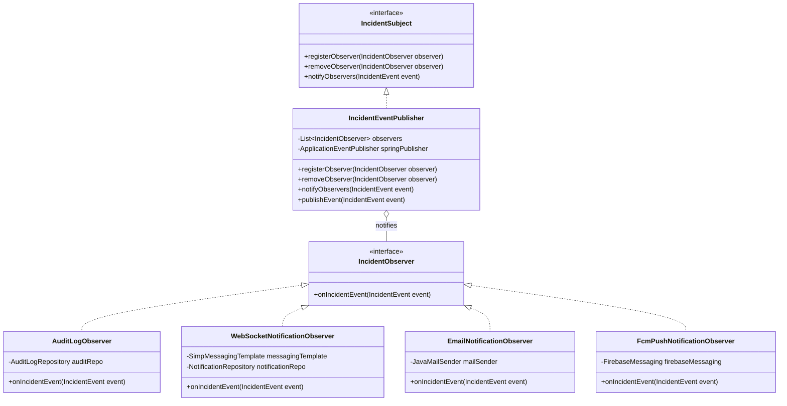

# Person 4: Service Desk, Notifications & Analytics
## Complete Implementation Blueprint & Execution Roadmap
**Role:** Service Desk Owner, Event Infrastructure & Operational Analytics Lead  
**Branch:** `feature/services-analytics`  
**Repository:** `BPHC-it-helpdesk`  
**Course:** CS F213 / MAC F212 OOP (Semester-I, 2026–2027)  
**Evaluation Rubric Alignment:** System Architecture (10), Functionality Implementation (60), Technical Depth & APIs (15), Innovation Challenges (10), Testing & Validation (5), Documentation & Demo (10).

---

## 1. Executive Summary & Module Mission

As **Person 4**, you own the **enterprise operational backbone and visibility layer** of the I-ITSM system:
1. **Service Catalog & Dependency Graph:** Managing the enterprise IT service inventory, baseline SLA weights, criticality factors ($C \in [1.0, 2.0]$), and upstream service dependencies (e.g., ERP depends on Database; Auth depends on Network), directly addressing the course **Innovation Challenge: Service Dependency Graph**.
2. **Event-Driven Observer Pattern:** Building the shared event infrastructure that decouples incident state mutations from downstream reactions. Implemented via a **Hybrid GoF Subject/Observer pattern** wrapping Spring's `ApplicationEventPublisher`.
3. **Multi-Channel Real-Time Notifications:**
   - **Real-Time In-App Alerts:** Live WebSocket connection (STOMP/SockJS) pushing notifications to logged-in user dashboards instantly without page reloads.
   - **Mobile Push Notifications:** Google Firebase Cloud Messaging (FCM) integration for mobile push alerts, with an adaptable fallback simulator.
   - **SMTP Email Notifications:** Formatted HTML/plain-text dispatch via JavaMailSender (Mailtrap / SendGrid).
4. **Database-Enforced Immutable Audit Trail:** Append-only event history capturing every action, actor, timestamp (UTC), previous/new state, and notes, protected by a PostgreSQL trigger blocking `UPDATE` and `DELETE`.
5. **Intelligent Feature — Multi-Metric Operational Bottleneck & Anomaly Engine:**
   - Multi-metric rule evaluation: Flags service bottlenecks when SLA breach rate $> 25\%$ or average resolution time exceeds baseline MTTR by $1.5\times$.
   - Recurring category spikes: Flags categories representing $> 35\%$ of active volume or exceeding 7-day moving averages by 2 standard deviations.
   - Technician capacity alarms: Flags technician bottlenecks when workload utilization reaches $\ge 80\%$.
6. **Centralized ITSM Operational Dashboard:** Interactive React dashboard powered by Tailwind CSS, Lucide Icons, and Recharts displaying real-time KPIs, workload capacity bars, service health matrices, interactive dependency graph visualizer, and live notification feeds.

---

## 2. Architecture & OOP Design Patterns



### GoF Pattern Justification for Oral Defense:
- **Observer Pattern:** Decouples the Incident Lifecycle (Person 1) and SLA Engine (Person 3) from side effects. When a ticket is created, assigned, acknowledged, or resolved, the lifecycle simply notifies `IncidentSubject`. Concrete observers (`AuditLogObserver`, `WebSocketNotificationObserver`, `EmailNotificationObserver`, `FcmPushNotificationObserver`) execute independently without altering core domain logic (Single Responsibility & Open/Closed Principle).
- **Adapter Pattern:** Notification channels adhere to a unified interface (`NotificationChannelAdapter`), allowing transparent swapping between simulated local logging, live SMTP, WebSockets, and Google FCM.

---

## 3. Detailed Component & File Specification

### 3.1 Backend Directory Structure (`backend/src/main/java/com/iitsm/`)
```
com.iitsm.
├── analytics/
│   ├── controller/
│   │   └── AnalyticsController.java       // GET /api/reports/*
│   ├── dto/
│   │   ├── DashboardOverviewDTO.java
│   │   ├── ServiceHealthDTO.java
│   │   ├── TechnicianWorkloadReportDTO.java
│   │   └── BottleneckInsightDTO.java
│   └── service/
│       ├── AnalyticsService.java
│       └── BottleneckDetectionEngine.java // Rule-based intelligent bottleneck & anomaly detection
├── audit/
│   ├── controller/
│   │   └── AuditLogController.java        // GET /api/audit-logs, GET /api/incidents/{id}/audit-trail
│   ├── model/
│   │   ├── AuditLog.java                  // JPA entity with immutable attributes
│   │   └── AuditAction.java               // Enum: CREATED, CLASSIFIED, ASSIGNED, ACKNOWLEDGED, etc.
│   ├── repository/
│   │   └── AuditLogRepository.java
│   └── service/
│       ├── AuditLogService.java
│       └── AuditLogObserver.java          // Implements IncidentObserver
├── events/
│   ├── IncidentEvent.java                 // Base domain event
│   ├── IncidentSubject.java               // GoF Subject interface
│   ├── IncidentObserver.java              // GoF Observer interface
│   └── IncidentEventPublisher.java        // GoF Subject implementation + Spring bridge
├── notification/
│   ├── config/
│   │   ├── WebSocketConfig.java           // STOMP endpoint /ws, topic /topic/notifications
│   │   └── FirebaseConfig.java            // FCM SDK initialization
│   ├── controller/
│   │   └── NotificationController.java    // GET /api/notifications, PATCH /api/notifications/{id}/read
│   ├── model/
│   │   ├── Notification.java              // Entity: id, recipientId, title, message, channel, read
│   │   └── NotificationChannel.java       // IN_APP_WS, EMAIL, FCM_PUSH
│   ├── repository/
│   │   └── NotificationRepository.java
│   ├── service/
│   │   ├── NotificationService.java
│   │   ├── WebSocketNotificationObserver.java // Pushes to STOMP topic
│   │   ├── EmailNotificationObserver.java     // Sends SMTP email
│   │   └── FcmPushNotificationObserver.java   // Sends mobile push via FCM
├── servicecatalog/
│   ├── controller/
│   │   └── ServiceCatalogController.java  // GET, POST, PUT /api/services
│   ├── dto/
│   │   ├── ServiceCreateRequest.java
│   │   └── ServiceResponseDTO.java
│   ├── model/
│   │   ├── ServiceEntity.java             // id, name, description, criticalityFactor, baseSlaWeight, status, baselineMttrMinutes
│   │   ├── ServiceDependency.java         // ManyToMany self-referencing upstream/downstream
│   │   └── ServiceStatus.java             // OPERATIONAL, DEGRADED, MAINTENANCE, OUTAGE
│   ├── repository/
│   │   └── ServiceCatalogRepository.java
│   └── service/
│       └── ServiceCatalogService.java
```

---

### 3.2 Frontend Directory Structure (`frontend/src/`)
```
frontend/src/
├── components/
│   ├── analytics/
│   │   ├── MetricKpiCard.jsx              // Modern KPI stat widget with percentage trends
│   │   ├── TechnicianWorkloadBarChart.jsx // Recharts Bar Chart of active workload vs capacity
│   │   ├── ServiceHealthDonutChart.jsx    // Recharts Pie/Donut Chart of ticket distribution
│   │   ├── ServiceDependencyGraph.jsx     // Visual interactive upstream/downstream dependency graph
│   │   └── BottleneckAlertBanner.jsx      // Visual warnings for SLA breaches & category spikes
│   ├── audit/
│   │   └── AuditTimeline.jsx              // Chronological timeline with filter by action & actor
│   ├── notifications/
│   │   ├── NotificationBell.jsx           // Header bell with unread badge counter
│   │   ├── NotificationDrawer.jsx         // Slide-over real-time alert feed
│   │   └── FcmPermissionBanner.jsx        // Push notification browser prompt
│   └── servicecatalog/
│       ├── ServiceCatalogList.jsx         // Grid view with health badges & criticality
│       └── ServiceConfigModal.jsx         // Modal to add/edit service & configure dependencies
├── pages/
│   ├── ItManagerDashboardPage.jsx         // Unified Executive ITSM Dashboard
│   ├── ServiceManagementPage.jsx          // Service Catalog and Dependency Admin
│   └── AuditLogsPage.jsx                  // Enterprise Audit Explorer
└── services/
    ├── analyticsApi.js                    // Axios calls for /api/reports/*
    ├── auditApi.js                        // Axios calls for /api/audit-logs
    ├── notificationApi.js                 // Axios calls for /api/notifications
    ├── serviceCatalogApi.js               // Axios calls for /api/services
    └── websocketService.js                // SockJS + STOMP client client connection
```

---

## 4. Step-by-Step Implementation Execution Plan

### Step 1: Database Entities & Immutability Trigger
1. Create PostgreSQL entities:
   - `services`: `id`, `name`, `code`, `description`, `criticality_factor` (NUMERIC), `base_sla_weight` (INT), `status` (VARCHAR), `baseline_mttr_minutes` (INT), `created_at`.
   - `service_dependencies`: `service_id`, `depends_on_service_id` (foreign keys to `services`).
   - `audit_logs`: `id`, `incident_id`, `timestamp` (UTC), `actor_id`, `actor_role`, `action`, `previous_state`, `new_state`, `description`.
   - `notifications`: `id`, `recipient_id`, `title`, `message`, `channel`, `is_read`, `created_at`.
2. Apply the PostgreSQL Immutability Trigger:
   ```sql
   CREATE OR REPLACE FUNCTION enforce_audit_log_immutability()
   RETURNS TRIGGER AS $$
   BEGIN
       RAISE EXCEPTION 'Audit records are strictly immutable. UPDATE and DELETE operations are forbidden.';
   END;
   $$ LANGUAGE plpgsql;

   CREATE TRIGGER trg_audit_logs_immutable
   BEFORE UPDATE OR DELETE ON audit_logs
   FOR EACH ROW EXECUTE FUNCTION enforce_audit_log_immutability();
   ```

### Step 2: GoF Observer Event Infrastructure
1. Define generic `IncidentEvent` record/class containing: `incidentId`, `actorId`, `actorRole`, `action`, `previousState`, `newState`, `timestamp`, `metadata`.
2. Implement `IncidentSubject` interface and `IncidentEventPublisher`.
3. Implement `AuditLogObserver`: Synchronously writes to `AuditLogRepository` within the active transaction.
4. Implement `WebSocketNotificationObserver`: Formats message and broadcasts over Spring `SimpMessagingTemplate` to `/topic/notifications/{recipientId}` and global `/topic/admin-alerts`.
5. Implement `EmailNotificationObserver`: Asynchronously builds email template and calls `JavaMailSender` (wrapped in try-catch so mail downtime never aborts transactions).
6. Implement `FcmPushNotificationObserver`: Dispatches push notification payload via Google Firebase Admin SDK.

### Step 3: Intelligent Bottleneck & Anomaly Detection Engine
1. Implement `BottleneckDetectionEngine`:
   - Metric A (Service SLA Breach Bottleneck): Evaluates incidents per service over rolling 24 hours. If `breachedCount / totalCount > 0.25`, emit `SERVICE_SLA_BOTTLENECK`.
   - Metric B (MTTR Degradation Bottleneck): If `actualAvgResolutionMinutes > 1.5 * baselineMttrMinutes`, emit `SERVICE_MTTR_BOTTLENECK`.
   - Metric C (Recurring Category Anomaly): Evaluates category distribution. If any category represents $> 35\%$ of active complaints, or volume exceeds $2\sigma$ above the 7-day moving average, emit `RECURRING_CATEGORY_SPIKE`.
   - Metric D (Technician Capacity Saturation): If technician active tickets $\ge 80\%$ of their capacity limit, emit `TECHNICIAN_CAPACITY_BOTTLENECK`.
2. Expose results via `GET /api/reports/bottlenecks`.

### Step 4: Service Catalog & Dependency Graph
1. Implement `ServiceCatalogService` with CRUD and dependency link/unlink methods.
2. Build cycle-prevention check (topological sort / depth-first search) to prevent circular service dependencies (e.g. A depends on B and B depends on A).
3. Expose dependency graph API: `GET /api/services/dependency-graph` returning nodes and edges for frontend visualization.

### Step 5: Real-Time WebSocket & FCM Configuration
1. Configure Spring WebSocket message broker:
   - STOMP endpoint: `/ws-iitsm` with SockJS fallback.
   - Application destination prefix: `/app`.
   - Simple broker destination prefix: `/topic`, `/queue`.
2. Configure Firebase Admin SDK using service account credentials (with graceful fallback if credentials are omitted in development).

### Step 6: Frontend Dashboard & Visualizations (React + Recharts + Tailwind)
1. Build `ItManagerDashboardPage.jsx`:
   - Metric cards: Total Incidents, Active Load, P1 Critical, SLA Violations, System MTTR.
   - Workload capacity chart: Bar chart showing assigned load vs max capacity per technician.
   - Service health donut chart: Visual distribution of tickets across services.
   - Bottleneck Alert Banners: Highlight identified bottlenecks with one-click drill down.
2. Build `ServiceDependencyGraph.jsx`: Interactive SVG/Canvas diagram showing service nodes (color-coded by operational status: Green/Yellow/Red) and directional dependency arrows.
3. Build `NotificationCenter.jsx` & `NotificationBell.jsx`: Real-time WebSocket connection displaying live toast popups when incidents are assigned or breached.
4. Build `AuditTimeline.jsx`: Searchable, filterable event timeline with badges for status transitions.

---

## 5. Person 4 Test Suite (4 Comprehensive Tests)

You will implement 4 robust JUnit 5 + Mockito tests covering normal operation, boundary conditions, exceptions, and business rules:

1. **Test 1 (Observer Pattern Audit Log Creation & Synchrony):**
   - *Scenario:* Publish `IncidentAssignedEvent`.
   - *Verification:* Assert that `AuditLogRepository.save()` was invoked with exact timestamp, previous state `CLASSIFIED`, new state `ASSIGNED`, and actor metadata.
2. **Test 2 (Database Immutability Enforcement):**
   - *Scenario:* Attempt to execute an update or delete query on an existing `AuditLog` entity.
   - *Verification:* Assert that the database trigger throws a `DataIntegrityViolationException` / SQL exception, verifying append-only immutability.
3. **Test 3 (Intelligent Bottleneck Detection Logic):**
   - *Scenario:* Feed mock dataset containing 10 incidents for "Payment/SSO" where 4 breached SLA (40% breach rate, $> 25\%$).
   - *Verification:* Assert that `BottleneckDetectionEngine.analyze()` detects `SERVICE_SLA_BOTTLENECK` with the exact affected service and recommendations.
4. **Test 4 (WebSocket & Multi-Channel Observer Dispatch):**
   - *Scenario:* Publish `SlaWarningEvent`.
   - *Verification:* Verify that `SimpMessagingTemplate.convertAndSend()` is called for the technician's private destination, and verify that an email failure is caught without throwing an uncaught exception.

---

## 6. Final Video Presentation Script (4–5 Minutes for Person 4)

| Timestamp | Screen Display | Talking Points & Defense Content |
| :--- | :--- | :--- |
| **0:00 – 1:00** | IT Manager Dashboard (`/admin/dashboard`) | "Hello, I am Person 4. I engineered the enterprise visibility, event infrastructure, and service intelligence of I-ITSM. Here you see our live Executive Dashboard displaying overall ticket health, SLA compliance rates, and technician load." |
| **1:00 – 2:00** | Service Catalog & Dependency Graph | "Here is the Service Catalog. We introduced Service Dependency Mapping as an innovation challenge. You can see how upstream outages in our Database directly affect downstream services like ERP. Each service has configurable SLA weights and criticality multipliers." |
| **2:00 – 3:00** | Bottleneck & Reporting Insights Engine | "Next is our Intelligent Bottleneck Engine. Rather than passive counters, our algorithm analyzes breach rates, MTTR inflation, and 7-day moving averages to flag recurring problems and technician saturation before catastrophic failures occur." |
| **3:00 – 4:00** | Live Notifications (WebSocket + Mobile Push) | "For real-time responsiveness, we implemented the Observer Pattern. Watch as an incident is resolved: our WebSocket broker pushes a live notification to the technician dashboard instantly, while triggering external push alerts." |
| **4:00 – 4:30** | Immutable Audit Trail (`/audit-logs`) | "Finally, all actions emit immutable audit records. Enforced at the PostgreSQL trigger level, nobody—not even an admin—can tamper with history, satisfying strict enterprise compliance." |
