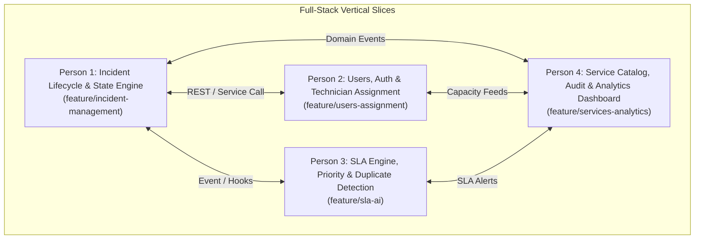
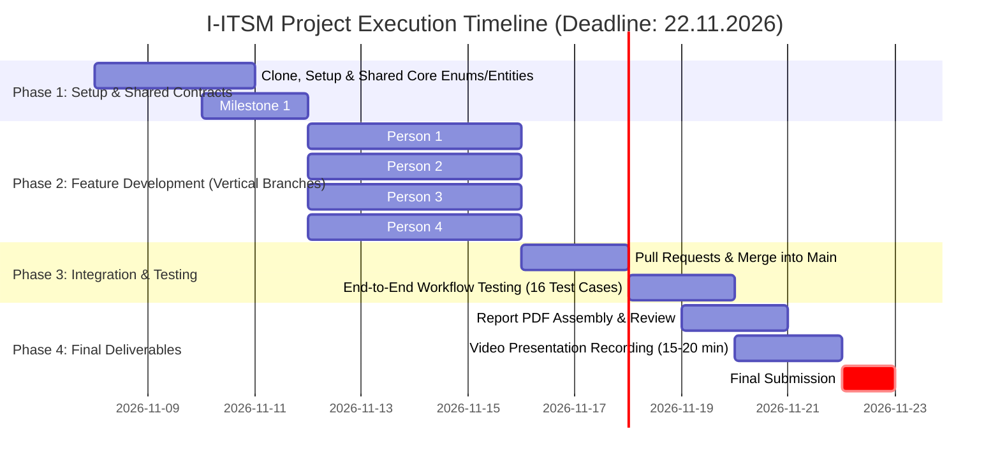

# Intelligent IT Service Management & Incident Resolution System (I-ITSM)
# Four-Person Team Roadmap & Implementation Blueprint
### Equal Workload, Equal Exposure: Full-Stack Vertical Slice Model
**Course:** CS F213 / MAC F212 Object-Oriented Programming (Semester-I, 2026–2027)  
**Submission Deadline:** 22.11.2026 (Report PDF + 15–20 min Video Presentation)  
**Core Scope:** Incident Creation, Sorting (Classification & Prioritization), Technician Assignment, and ITSM Dashboard Handling (No Payment/Billing Gateways).

---

## 1. Architectural Philosophy: The Vertical Slice Model

To ensure **equal workload, equal exposure, and individual accountability** for group grading and the recorded video defense, the project is divided into **four end-to-end vertical modules**. Every team member writes:
1. **Frontend UI** (React components, forms, tables, dashboards).
2. **Backend Java & OOP** (Domain models, services, business logic, design patterns).
3. **Database & Persistence** (PostgreSQL schema, Spring Data JPA repositories).
4. **REST APIs & DTOs** (Spring Boot `@RestController`, validation, error handling).
5. **Automated Testing** (At least 4 unit and integration test cases covering happy path, boundaries, exceptions, and business rules).
6. **Documentation & Demo Segment** (UML/ER/algorithm documentation and individual presentation in the video demo).

---

## 2. Shared Foundational Contracts (Day 1 Agreement)

Before writing independent code, the team must agree on shared identifiers and common domain models located in `backend/src/main/java/com/iitsm/core/`:

### Enums
- `IncidentStatus`: `NEW`, `CLASSIFIED`, `ASSIGNED`, `ACKNOWLEDGED`, `IN_PROGRESS`, `RESOLVED`, `VERIFIED`, `CLOSED`
- `Priority`: `P1_CRITICAL`, `P2_HIGH`, `P3_MEDIUM`, `P4_LOW`
- `Urgency`: `LOW`, `MEDIUM`, `HIGH`, `CRITICAL`
- `Impact`: `INDIVIDUAL`, `DEPARTMENT`, `ORGANIZATION_WIDE`
- `IncidentCategory`: `HARDWARE`, `SOFTWARE`, `NETWORK`, `DATABASE`, `CLOUD`, `SECURITY`, `AUTHENTICATION`, `APPLICATION`, `STORAGE`
- `UserRole`: `ROLE_EMPLOYEE`, `ROLE_TECHNICIAN`, `ROLE_TEAM_LEAD`, `ROLE_ADMIN`
- `AvailabilityStatus`: `AVAILABLE`, `ON_LEAVE`, `OFF_DUTY`
- `SlaStatus`: `NORMAL`, `WARNING`, `BREACHED`

---

## 3. Person-by-Person Implementation Roadmap

---

### PERSON 1: Incident Lifecycle, State Engine & Core Workflow Lead
- **Git Branch:** `feature/incident-management`
- **Domain Focus:** Core incident entity, valid state transitions, ticket workflow, resolution & verification.
- **Primary Design Pattern:** **State Pattern** (encapsulating status transitions and blocking illegal jumps).

#### Vertical Slice Responsibilities:
1. **Frontend (React):**
   - Incident Reporting Form (`CreateIncidentForm.jsx`): Title, description, category dropdown, service selector, urgency, impact.
   - Incident Detail & Lifecycle Actions Screen (`IncidentDetailView.jsx`): Displays ticket metadata, action buttons (`Acknowledge`, `Start Investigation`, `Resolve`, `Verify`, `Close`), and validation errors for illegal actions.
   - Public Incident Timeline / Comment thread.
2. **Backend & OOP (Java):**
   - Core Domain Entities: `Incident`, `IncidentComment`.
   - State Pattern Hierarchy:
     - Interface: `IncidentState` (`handleAcknowledge()`, `handleStartInvestigation()`, `handleResolve()`, `handleVerify()`, `handleClose()`).
     - Concrete Classes: `NewState`, `ClassifiedState`, `AssignedState`, `AcknowledgedState`, `InProgressState`, `ResolvedState`, `VerifiedState`, `ClosedState`.
   - Business Service: `IncidentService` (create, update, change state, verify resolution, validate permissions).
   - Custom Exceptions: `InvalidStateTransitionException`, `IncidentNotFoundException`.
3. **Database (PostgreSQL & JPA):**
   - Tables: `incidents`, `incident_comments`.
   - Spring Data JPA: `IncidentRepository`, `IncidentCommentRepository`.
4. **REST APIs:**
   - `POST /api/incidents` — Create new incident.
   - `GET /api/incidents/{id}` — Fetch single incident details.
   - `PATCH /api/incidents/{id}/acknowledge` — Technician acknowledges ticket.
   - `PATCH /api/incidents/{id}/investigate` — Move to `IN_PROGRESS`.
   - `PATCH /api/incidents/{id}/resolve` — Submit fix details and move to `RESOLVED`.
   - `PATCH /api/incidents/{id}/verify` — Requester confirms fix and moves to `VERIFIED`.
   - `PATCH /api/incidents/{id}/close` — Formal closure and immutable lock.
5. **Testing (JUnit 5 & Mockito):**
   - Test 1 (Happy Path): Complete lifecycle walkthrough from `NEW` to `CLOSED`.
   - Test 2 (Boundary/Invalid State): Attempting `NEW -> CLOSED` or `ASSIGNED -> RESOLVED` throws `InvalidStateTransitionException`.
   - Test 3 (Business Rule): Resolving without resolution notes fails validation.
   - Test 4 (Authorization): Non-reporter cannot verify or close someone else's incident.
6. **Documentation & Video Demo Segment:**
   - Deliverables: UML Class Diagram (domain entities + State Pattern hierarchy), Use Case Diagram.
   - Demo Responsibility: Walk through ticket creation, demonstrate state progression, show blocked illegal state transitions, and explain the State Pattern implementation.

---

### PERSON 2: Users, Security & Technician Assignment Lead
- **Git Branch:** `feature/users-assignment`
- **Domain Focus:** User accounts, authentication/JWT, technician skills/capacity, and dynamic technician assignment.
- **Primary Design Pattern:** **Strategy Pattern** (interchangeable assignment algorithms).

#### Vertical Slice Responsibilities:
1. **Frontend (React):**
   - Login & Registration Pages (`Login.jsx`, `Register.jsx`): JWT storage, role-based redirection.
   - Technician Workload & Skill Management Screen (`TechnicianDirectory.jsx`): Admins view technician active queues, skill tags, and toggle availability.
   - Technician Personal Profile view (`TechnicianProfile.jsx`): Status toggle (`AVAILABLE`, `ON_LEAVE`, `OFF_DUTY`).
2. **Backend & OOP (Java):**
   - Core Domain Entities: `User` (abstract), `Employee`, `Technician`, `Role`.
   - Assignment Strategy Hierarchy:
     - Interface: `AssignmentStrategy` (`Technician assign(Incident incident, List<Technician> availableTechnicians)`).
     - Concrete Classes:
       - `SkillBasedAssignmentStrategy` (matches incident category to technician certified skills; picks lowest active load).
       - `LoadBasedAssignmentStrategy` (calculates active load ratio across all technicians).
       - `RoundRobinAssignmentStrategy` (fallback fair cyclical dispatch).
   - Context Class: `TechnicianAssignmentService` (dispatches based on active strategy configured by admin).
   - Security: Spring Security filter chain, `JwtTokenProvider`, BCrypt password encoder, `@PreAuthorize` role guards.
   - Custom Exceptions: `TechnicianUnavailableException`, `WorkloadExceededException`, `UnauthorizedOperationException`.
3. **Database (PostgreSQL & JPA):**
   - Tables: `users`, `employees`, `technicians`, `technician_skills`.
   - Spring Data JPA: `UserRepository`, `TechnicianRepository`.
   - Database Seed: Initial admin, team lead, and 5 technicians with diverse skill sets.
4. **REST APIs:**
   - `POST /api/auth/login` & `POST /api/auth/register` — User authentication.
   - `GET /api/technicians` — List technicians with current active workloads.
   - `PUT /api/technicians/{id}/availability` — Update status (`AVAILABLE`, `ON_LEAVE`).
   - `POST /api/admin/assignment-strategy` — Switch active strategy (`SKILL_BASED` vs `LOAD_BASED`).
   - `POST /api/incidents/{id}/assign` — Execute assignment strategy or manual re-assignment.
5. **Testing (JUnit 5 & Mockito):**
   - Test 1 (Skill Match): Incident of category `NETWORK` assigns only to a technician with the `NETWORK` skill tag.
   - Test 2 (Workload Cap): When a technician hits `maxConcurrentWorkload` (5), assignment skips them and picks the next candidate.
   - Test 3 (Strategy Swapping): Verifying that switching assignment strategy changes the selected technician.
   - Test 4 (Security): Employee attempting to call admin technician endpoints receives HTTP 403 Forbidden.
6. **Documentation & Video Demo Segment:**
   - Deliverables: ER Diagram, Database Schema, Swagger API documentation.
   - Demo Responsibility: Demonstrate user login/RBAC, technician skill and availability management, automated technician dispatch via Strategy Pattern, and workload cap protection.

---

### PERSON 3: SLA Engine, Priority Scoring & Duplicate Detection Lead
- **Git Branch:** `feature/sla-ai`
- **Domain Focus:** Multi-factor priority calculation, dual-milestone SLA monitoring, automated escalations, and intelligent duplicate detection.
- **Primary Design Pattern:** **Strategy Pattern** (Priority calculation) + **Template Method / Command** (SLA checking).

#### Vertical Slice Responsibilities:
1. **Frontend (React):**
   - SLA Countdown Badges & Warning Chips (`SlaTimerBadge.jsx`): Dynamic countdown showing remaining response and resolution time with color changes (Green $\rightarrow$ Yellow warning at 75% $\rightarrow$ Red breach).
   - Duplicate Incident Banner (`DuplicateIncidentAlert.jsx`): Displays flagged similar tickets on ticket creation and technician view.
   - Priority Calculation Inspector (`PriorityBreakdownModal.jsx`): Visualizes how the score was calculated ($I \times U \times C + W$).
2. **Backend & OOP (Java):**
   - Core Domain Entities: `SlaPolicy`, `PriorityScoreCalculator`.
   - Priority Scoring Engine:
     $$\text{Score} = (\text{Impact} \times \text{Urgency} \times \text{Business Criticality Factor}) + \text{Service Weight}$$
     Maps deterministically into P1, P2, P3, P4.
   - SLA Background Scheduler (`SlaMonitoringScheduler`):
     - Annotated with `@Scheduled(fixedRate = 60000)` (every 60s).
     - Evaluates active tickets: Checks Response Target (vs `ACKNOWLEDGED`) and Resolution Target (vs `RESOLVED`).
     - Emits `SlaWarningEvent` at 75% elapsed duration; marks `slaBreached = true` at 100%.
   - Intelligent Feature 1 (Duplicate Detection Engine):
     - Class: `DuplicateDetectionService` (tokenized Jaccard similarity & Levenshtein metric).
     - Flags duplicates when similarity $\ge 0.80$ for tickets affecting the same service within 24 hours.
   - Intelligent Feature 2 (Multi-Tier Automatic Escalation):
     - Unacknowledged P1 after 5 minutes $\rightarrow$ Auto-escalates to Team Lead.
     - Unresolved P1 after 75% SLA $\rightarrow$ Escalates to IT Administrator.
   - Custom Exceptions: `SlaBreachedException`, `InvalidPriorityScoreException`.
3. **Database (PostgreSQL & JPA):**
   - Tables: `sla_policies`, `incident_sla_tracking`.
   - Spring Data JPA: `SlaPolicyRepository`.
4. **REST APIs:**
   - `POST /api/incidents/calculate-priority` — Compute priority score and tier.
   - `POST /api/incidents/detect-duplicates` — Check incoming text against active tickets.
   - `GET /api/sla/policies` & `PUT /api/sla/policies/{id}` — Configure SLA targets.
   - `POST /api/incidents/{id}/escalate` — Trigger manual or automated escalation.
5. **Testing (JUnit 5 & Mockito):**
   - Test 1 (Priority Score): Validating priority calculation formula across low, medium, and critical service inputs.
   - Test 2 (SLA 75% Warning): Verifying that when 75% of the target window elapses, `SlaWarning` is emitted.
   - Test 3 (SLA Breach Flagging): Verifying that tickets exceeding 100% time are marked breached.
   - Test 4 (Duplicate Detection): Verifying two tickets with identical titles ("Hostel Wi-Fi Down") produce similarity $\ge 0.80$ and link parent ID.
6. **Documentation & Video Demo Segment:**
   - Deliverables: Prioritization Algorithm Rationale, SLA State Chart, Duplicate Detection Formula Documentation.
   - Demo Responsibility: Show priority calculation in action, trigger the SLA countdown/warning at 75%, demonstrate simulated duplicate ticket detection, and show automatic ticket escalation.

---

### PERSON 4: Service Catalog, Audit Trail & Operational Analytics Lead
- **Git Branch:** `feature/services-analytics`
- **Domain Focus:** IT Service catalog, event-driven notifications, immutable audit logging, and the centralized ITSM Operational Dashboard.
- **Primary Design Pattern:** **Observer Pattern** (event publisher and listeners for decoupled audit and notifications).

#### Vertical Slice Responsibilities:
1. **Frontend (React):**
   - Centralized ITSM Operational Dashboard (`ItManagerDashboard.jsx`):
     - Key Metrics: Total Tickets, Open Tickets, P1 Critical, SLA Violations, Resolved Count.
     - Service Health Matrix: Active incidents grouped by digital service.
     - Technician Workload Bar Chart / Grid.
   - Service Catalog Management Screen (`ServiceCatalog.jsx`): Admins create and edit services (e.g., Network, SSO, ERP, Database) with criticality weights.
   - Audit Trail & Activity Feed Component (`AuditHistoryTimeline.jsx`): Displays chronological history of ticket events.
   - Notification Bell & Dropdown (`NotificationCenter.jsx`): Real-time alert list with read/unread toggles.
2. **Backend & OOP (Java):**
   - Core Domain Entities: `ServiceCategory`, `AuditLog`, `Notification`.
   - Observer Pattern Architecture:
     - Domain Events: `IncidentCreatedEvent`, `IncidentStatusChangedEvent`, `SlaWarningEvent`, `IncidentAssignedEvent`.
     - Event Publisher: Spring `ApplicationEventPublisher`.
     - Event Listeners:
       - `AuditLogEventListener` (records immutable log: timestamp, actor, previous state, new state, notes).
       - `InAppNotificationEventListener` (persists notification and pushes to user feed).
       - `EmailNotificationEventListener` (constructs and dispatches email via JavaMailSender / SMTP).
   - Reporting & Analytics Service: `AnalyticsService` (aggregates workload, MTTR, breach rates, service health).
   - Custom Exceptions: `ServiceNotFoundException`, `NotificationDeliveryException`.
3. **Database (PostgreSQL & JPA):**
   - Tables: `services`, `audit_logs`, `notifications`.
   - Spring Data JPA: `ServiceRepository`, `AuditLogRepository`, `NotificationRepository`.
4. **REST APIs:**
   - `GET /api/services` & `POST /api/services` — Manage IT services and criticality.
   - `GET /api/reports/overview` — Dashboard summary metrics.
   - `GET /api/reports/technician-workload` — Technician active ticket counts vs. capacity.
   - `GET /api/reports/service-health` — Incidents breakdown by service.
   - `GET /api/incidents/{id}/audit-trail` — Fetch immutable ticket history.
   - `GET /api/notifications` — Fetch user notification feed.
5. **Testing (JUnit 5 & Mockito):**
   - Test 1 (Audit Log Synchrony): Every status transition generates an exact audit entry with actor and timestamp.
   - Test 2 (Observer Notification): Firing `IncidentAssignedEvent` creates an in-app notification for the assigned technician.
   - Test 3 (Audit Immutability): Verifying audit records cannot be edited or deleted.
   - Test 4 (Analytics Aggregation): Verifying dashboard counters accurately reflect active, resolved, and breached tickets.
6. **Documentation & Video Demo Segment:**
   - Deliverables: Observer Pattern Class Diagram, System Architecture Overview Diagram, Notification Workflow Spec.
   - Demo Responsibility: Demonstrate the operational dashboard metrics, showcase the immutable audit trail, display live notifications, and explain the Observer Pattern implementation.

---

## 4. Master Timeline: Day-by-Day Execution Plan

### Phase 1: Setup & Shared Contracts (Nov 8 – Nov 11)
- **Day 1:** Clone repository, set up PostgreSQL database `iitsm_db`, verify Spring Boot and React run locally.
- **Day 2:** Person 1 commits shared enums (`IncidentStatus`, `Priority`, `UserRole`) and base models to `main`.
- **Day 3:** Connect React to Spring Boot. **Milestone 1 achieved:** Submit ticket via React form $\rightarrow$ saved in PostgreSQL $\rightarrow$ displayed in list.

### Phase 2: Independent Vertical Development (Nov 12 – Nov 15)
- Each member develops their complete vertical module on their dedicated branch.
- Person 1 implements State Pattern and lifecycle endpoints.
- Person 2 implements JWT login and Strategy Pattern assignment.
- Person 3 implements priority calculation, SLA scheduler, and duplicate detection.
- Person 4 implements service catalog, Observer audit logging, and executive dashboard.

### Phase 3: Integration, Merging & Test Suite (Nov 16 – Nov 18)
- Create Pull Requests into `main`. Review code collaboratively and resolve merge conflicts.
- Connect all four modules into the complete end-to-end lifecycle.
- Execute the complete test suite: 4 tests $\times$ 4 members = **16 comprehensive unit & integration tests**.

### Phase 4: Report Assembly & Demo Recording (Nov 19 – Nov 22)
- Assemble the final project report PDF combining Deliverables 1–8.
- Script and record the **15–20 minute video demonstration** covering the 3 mandatory workflows:
  - **Workflow 1:** Employee reports incident $\rightarrow$ priority calculated $\rightarrow$ technician assigned $\rightarrow$ notification dispatched.
  - **Workflow 2:** Technician investigates $\rightarrow$ SLA countdown monitored $\rightarrow$ incident resolved $\rightarrow$ employee verifies and closes ticket.
  - **Workflow 3:** Multiple tickets submitted $\rightarrow$ duplicate detected $\rightarrow$ unacknowledged ticket automatically escalated.
- Upload video and PDF before **22.11.2026 (Hard Deadline)**.

---

## 5. Git Branching & Collaboration Rules

1. **Main Branch Protection:** No direct commits to `main`. All work occurs on:
   - `feature/incident-management` (Person 1)
   - `feature/users-assignment` (Person 2)
   - `feature/sla-ai` (Person 3)
   - `feature/services-analytics` (Person 4)
2. **Pull Requests:** When merging to `main`, at least one other team member must review the PR.
3. **Commit Messages:** Use clear prefixes:
   - `feat: implement SkillBasedAssignmentStrategy`
   - `test: add invalid state transition test cases`
   - `fix: correct SLA warning threshold calculation`
