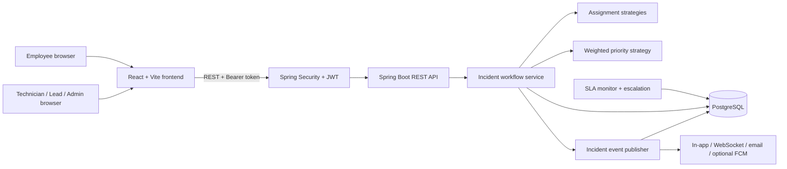
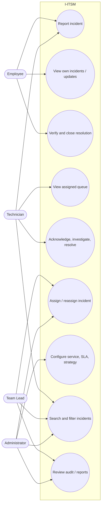
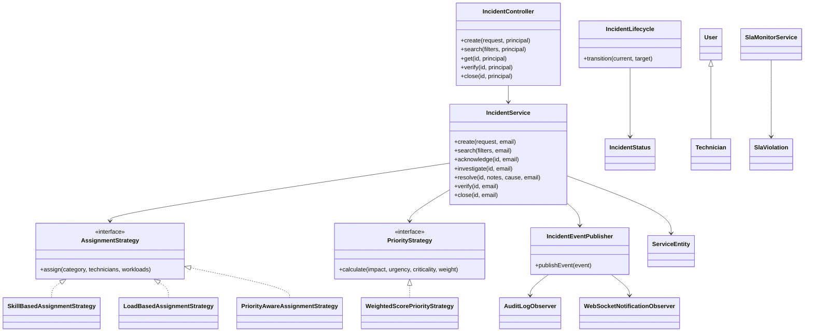

# Architecture and UML

## System architecture

The application is a single Spring Boot API and a React client. PostgreSQL is
the system of record. REST requests carry signed JWTs; the backend derives the
actor from the authenticated identity and applies record-level ownership rules.
Incident state changes and their audit entries run in the same transaction.
The SLA scheduler reads open incidents on a 60-second cadence and records
warnings and breaches idempotently.

## Use case diagram

## Class diagram (principal design)

The backend persists incident rows through parameterized JDBC queries alongside
Spring Data JPA repositories for users, services, audit, notifications, and SLA
records. The Strategy Pattern chooses priority and technician selection; the
Observer Pattern sends audit and notification effects after domain operations.
The current incident persistence is intentionally described accurately: it is
JDBC-based, not a JPA `Incident` entity.

## Decision support and ticket chat

The priority panel shows the inputs used by the weighted score:
`impact × urgency × service criticality + service weight`, followed by the
configured P1–P4 score band. The incident form also compares its title and
description with resolved incidents for the same service and category. It ranks
up to three prior resolutions using the existing deterministic token similarity
strategy. Employees only receive suggestions from their own resolved tickets;
technicians receive suggestions from tickets they reported or were assigned;
leads and administrators can use the full history. Suggested resolution notes
are advisory and remain visible only to authenticated users in that scope.

Desk Buddy is a small browser-side, rule-based helper in the incident workspace.
It reads the already authorized incident list and selected incident to answer
status, assignment, SLA deadline, resolution, and next-step questions. It makes
no external model calls and does not create or change ticket data.
