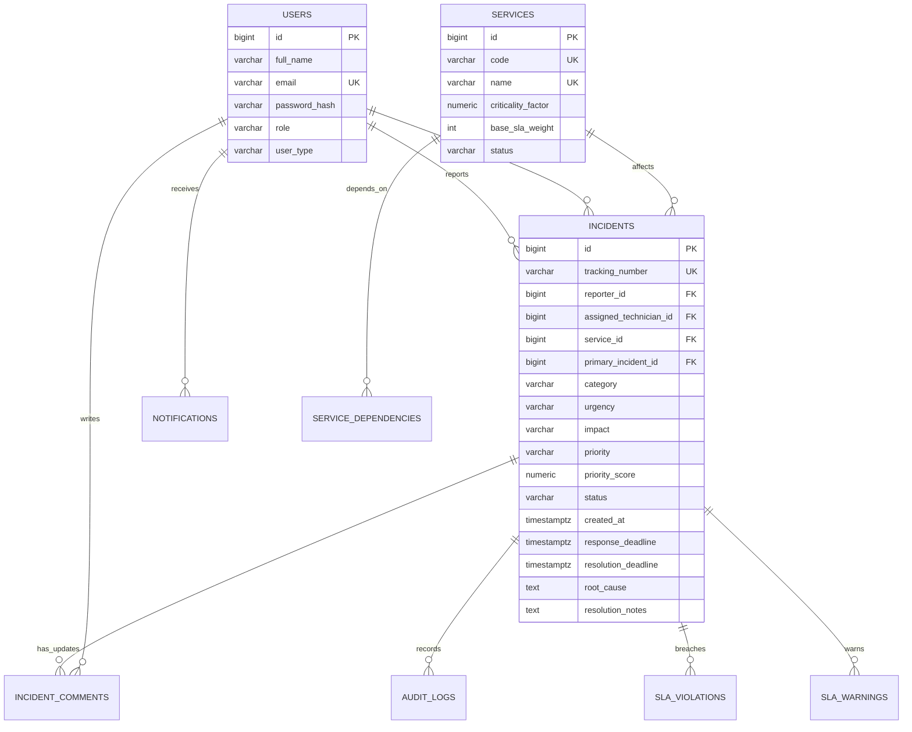

# Database design

PostgreSQL is the persistent store. The schema is defined in
`backend/src/main/resources/schema.sql`; local development seed data is in
`backend/src/main/resources/data.sql`. The demo script seeds services and SLA
policies, but deliberately does not seed accounts with fixed passwords.

The incident row keeps the current state and SLA milestones. Comments capture
user/technician progress updates; audit logs are append-only and record
transitions and automation. Duplicate incidents use `primary_incident_id` to
point to the original incident. SLA warnings and violations are separate rows
so repeated scheduler cycles can be idempotent.

Resolution suggestions reuse resolved incident rows and require no separate
model or table. Candidates match the requested service and category, then the
existing deterministic title/description similarity strategy ranks the top
three. Query scope follows incident visibility: employees see their own
history, technicians see tickets they reported or handled, and leads/admins see
the team history. The UI also explains priority from the stored score inputs.

Duplicate comparison is deterministic token-set Jaccard similarity over the
combined title and description. Text is lowercased, non-alphanumeric characters
are treated as spaces, tokens are split on whitespace, and a small fixed set of
common English stop words (`the`, `a`, `an`, `is`, `are`, `to`, `of`, `and`,
`in`, `on`, `for`, `it`, `not`, `my`, `i`, `unable`, `cannot`, `cant`) is
removed. A new report is compared only with active
incidents for the same service created in the previous 24 hours; a score of at
least 0.80 links it to the highest-scoring match's primary incident. This
normalization and score are implemented in the incident service.

Sample service records are inserted by `data.sql`: Central Authentication,
Corporate Network & VPN, Database Cluster, ERP & Student Portal, Cloud Storage,
and Developer/CI Platform. SLA seed targets follow P1 5/30 minutes, P2 15/120,
P3 60/480, and P4 240/1440.

## Data integrity and indexes

- Foreign keys connect reporters, technicians, services, parent incidents, and
  comments.
- Incident IDs and service codes are unique; user emails are unique.
- `assigned_at`, `acknowledged_at`, `resolved_at`, and `closed_at` store UTC
  instants as `TIMESTAMPTZ`.
- Duplicate searches are supported by an index on service, creation time, and
  status; reporter history has an index on reporter and descending creation
  time.
- The audit log trigger rejects updates and deletes in PostgreSQL.
